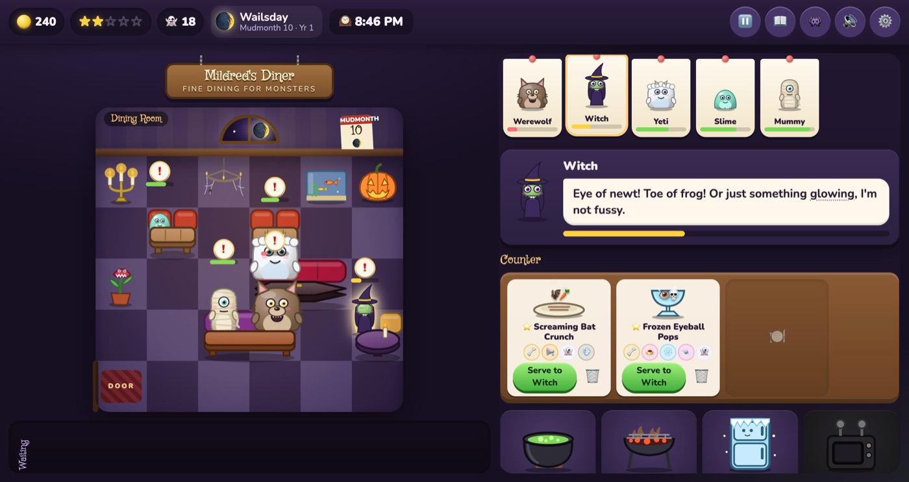

# 🍽️ Restaurant for Monsters

> *Fine dining for the dearly un-departed.*

You've inherited your great-aunt Mildred's run-down diner… only to discover it's the most popular restaurant in the monster world. The regulars are vampires, swamp creatures, werewolves, mummies and a *very* polite kraken. Nobody knows what monsters eat, so you'll have to experiment: decode their riddle-orders, combine strange ingredients at bubbling cauldrons and lightning ovens, and try not to set the customers on fire. (They're fine. Mostly.)

A cozy-spooky, family-friendly cooking game that runs in any modern browser, on desktop or phone.

### ▶️ [Play at monsters.carterscoding.com](https://monsters.carterscoding.com)



<sub>Screenshot placeholder: replace `assets/screenshot.jpeg` with your own favourite moment.</sub>

---

## How to play

1. **Open for the night.** Each shift is one in-game night, from 6 PM to 2 AM.
2. **Monsters arrive and sit down.** Tap a monster (or its ticket in the kitchen) to read its order.
3. **Decode the riddle.** Orders are written in monster-speak: *"soup, but sad"* means a dish that is **Soupy** and **Gloomy**, and *"something crunchy that screams a little"* means **Crunchy** and **Loud**. Every phrase you decode is saved in your Phrasebook and gets a hint icon in future orders.
4. **Cook.** Put up to 3 ingredients in the bowl, then tap a station. A dish gets every trait its ingredients have, plus the station's trait:

   | Station | Adds | Removes |
   |---|---|---|
   | 🫕 Cauldron | Soupy | — |
   | 🔥 Grill | Smoky | Cold |
   | 🧊 Freezer | Cold | Spicy, Smoky |
   | ⚡ Lightning Oven | Zappy | — |

   An ingredient's traits stay a mystery until you cook with it.
5. **Serve before their patience runs out.** Delighted monsters pay and tip well. Some combos backfire hilariously (two cursed ingredients summon a tiny angry ghost that eats your tips). Some traits set certain monsters comically on fire.
6. **Between shifts,** buy ingredients, upgrades and staff, decorate in **Build Mode**, and check the **calendar** for moon phases, festivals and rumoured health inspections.

**More to discover:**
- Six regulars with storylines, including a vampire on a garlic-free diet and a ghost who remembers Great-Aunt Mildred's lost soup.
- A gargoyle food critic, ghost tour bus rushes and full-moon werewolf packs.
- A dragon who wants food cooked with his own sneeze.
- Seasonal festivals and the **Monster Food Awards** at the end of the first in-game year, followed by endless mode.

**Tips:** Dirty tables (🍽️) need a tap to clean before anyone else can sit there. Trolls only sit at a *Reinforced Giant Table*. Some monsters only visit once your restaurant is spooky enough.

## Features at a glance

- **Riddle orders:** 22 monster types (including the food critic), each with its own voice, likes, dislikes and tipping style. Orders are always solvable with your unlocked pantry.
- **33 ingredients**, **27 signature recipes** and **8 backfires** to discover. Working combos are saved to the Recipe Book for one-tap re-cooking.
- **In-game calendar:** 7-night weeks, 4-week months, 4 seasons per year, an 8-night moon cycle with different effects per phase, and four seasonal festivals.
- **Health inspector minigame:** keep things looking "normal" while a human with a clipboard scans the room.
- **Build Mode:** grid editor with tap or drag placement, rotate, move and sell. Furniture affects seating and comfort; decorations add Spookiness. Five themes, custom wallpaper, floor, lighting, name and sign, plus expansions (bigger room, back room, graveyard patio).
- **Staff** with perks *and* quirks, **goals** that unlock content, auto-save, a tutorial, a Monster Guide, settings (sound, animation speed, shift pace) and reduced-motion support.
- Every sprite is drawn with layered SVG and animated with CSS (breathing, blinking, reactions, steam, flames). Sound effects are synthesized live with the Web Audio API.

## Running it locally

The game uses **ES modules**, which browsers won't load from `file://` URLs, so you need a tiny local web server. Any of these work from the project folder:

```bash
npx serve                     # Node.js, then open the URL it prints
python3 -m http.server 8000   # Python, then open http://localhost:8000
```

You can also use the **Live Server** extension in VS Code: right-click `index.html` → *Open with Live Server*.

There is no build step, no framework and no dependencies. Edit a file, refresh, done.

**Developer extras:**
- `tools/gallery.html` (e.g. `http://localhost:8000/tools/gallery.html`) shows every monster, mood, piece of furniture, decoration and station. It's handy when adding content.
- In the browser console, `RFM.game.state` holds your save data, if you'd like to give yourself a few thousand coins "for testing".

## Deploying with GitHub Pages (monsters.carterscoding.com)

The repo is ready for GitHub Pages as-is. All paths are relative, and the `CNAME` file already contains `monsters.carterscoding.com`.

1. Push to GitHub (`main` branch).
2. In the repo, go to **Settings → Pages**. Under **Build and deployment**, choose **Deploy from a branch**, branch **`main`**, folder **`/ (root)`**, and save.
3. In the same Pages settings, check that **Custom domain** says `monsters.carterscoding.com` (it's read from the `CNAME` file). Enter it and save if it's empty.
4. At your DNS provider for `carterscoding.com`, add a record:

   | Type | Name / Host | Value / Target |
   |---|---|---|
   | `CNAME` | `monsters` | `cksarge.github.io` |

5. Wait for DNS to propagate (minutes to a few hours). Then tick **Enforce HTTPS** in the Pages settings once it becomes available.

## Adding your own content

All content lives in `data/` as plain JavaScript files. You can add monsters, ingredients and decorations without touching any game logic. Each file starts with a comment explaining every field.

**New ingredient** (`data/ingredients.js`):
```js
{ id: 'ghost-toast', name: 'Ghost Toast', emoji: '🍞', traits: ['spooky', 'crunchy'], cost: 3, rep: 1.5,
  desc: 'Toast that passes straight through the plate.' },
```
`rep: 1.5` makes it appear in the Market at 1.5★. Use `start: true` for the starting pantry, `reward: true` for goal/story unlocks, or `event: 'harvest-moon'` for a limited-time item.

**New monster** (`data/monsters.js`): copy an existing entry and change it. The `art` block builds the sprite from parts:
```js
art: { body: 'round', color: '#7ad9ff', eyes: 3, eyeColor: '#222', mouth: 'grin', extras: ['horns', 'scarf'], accent: '#ff7ad9' },
```
Body shapes: `tall`, `round`, `blob`, `ghost`, `wide`, `tentacle`, `skeleton`, `human`, `small`. Extras include `cape`, `wings`, `horns`, `ears-wolf`, `snout`, `bandages`, `hat-witch`, `top-hat`, `monocle`, `snakes`, `antennae`, `fluff` and more (see `EXTRAS` in `js/ui/sprites.js`). Check the result in `tools/gallery.html`.

Handwritten orders use a tiny markup, where `[phrase|trait]` marks a phrase that secretly means a trait:
```js
orders: [{ riddle: 'Something [crunchy|crunchy] that [screams a little|loud]!' }],
```

**New decoration** (`data/decorations.js`): give it an `art` name from `DECOR_ART` in `js/ui/sprites.js` (or add your own drawing there), plus `spook` and the monsters it `loves`.

**Also easy to extend:** signature recipes and backfires (`data/recipes.js`), riddle phrases (`data/riddles.js`), furniture (`data/furniture.js`), themes, wallpapers and floors (`data/themes.js`), festivals and moon phases (`data/events.js`), staff (`data/helpers.js`), upgrades (`data/upgrades.js`), goals (`data/goals.js`) and regulars' storylines (`data/regulars.js`).

A quick data check runs on start-up: typos like an unknown trait show up as a warning in the browser console.

## Project structure

```
index.html            The page shell: screens, HUD, panes and overlay layers
CNAME                 Custom domain for GitHub Pages
css/
  base.css            Colour tokens, fonts, buttons, cards, bars
  layout.css          HUD, views, desktop/phone pane layout
  dining.css          Rooms, furniture, seated monsters, bubbles, the sign
  kitchen.css         Tickets, riddle, counter, stations, bowl, pantry
  build.css           Build Mode grid, previews, catalog, styles, themes
  panels.css          Modals, toasts, hub, shop, Recipe Book, guide, calendar
  screens.css         Title, letter, night report, awards, inspector minigame
  animations.css      Every animation (all scaled by the animation-speed setting)
js/
  main.js             Boots the game and moves between screens
  state.js            Saved game state, new-game defaults, tiny event bus
  save.js             localStorage save/load, all wrapped in try/catch
  db.js               Imports every data file and indexes it by id
  calendar.js         Nights, weeks, months, seasons, moon phases, schedules
  riddles.js          Turns traits into monster-speak (and back)
  cooking.js          Dish traits, recipes, backfires, judging dishes
  customers.js        Who visits, orders, seating, patience, payment
  shift.js            The night loop: clock, arrivals, cooking, serving
  economy.js          Shop, upgrades, staff, Spookiness, goals, rewards
  events.js           Health inspector minigame
  build.js            Build Mode
  layout.js           Room grid maths shared by Build Mode and the dining room
  tutorial.js         The guided first night
  audio.js            Synthesized sound effects (Web Audio API)
  utils.js            Random helpers, DOM builder, formatting
  ui/                 Rendering: sprites, HUD, dining room, kitchen, hub,
                      modals, screens, effects, popup layout manager
data/                 All game content (see "Adding your own content")
assets/
  fonts/              Self-hosted Griffy + Nunito fonts and their licenses
  icons/              Favicon
  screenshot.jpeg     README screenshot
tools/
  gallery.html        Developer sprite gallery
```

**Saving:** progress auto-saves to your browser's `localStorage` after every shift and every Build Mode change. If you reload in the middle of a night, that night restarts from the beginning. If storage isn't available (e.g. some private-browsing modes), the game still runs; it just can't remember you.

## Credits & license

- **Code, game design and art:** Carter K. All monster, furniture, decoration and station art is original SVG drawn in code (`js/ui/sprites.js`).
- **Sound effects:** synthesized at runtime with the Web Audio API. No audio files are used.
- **Fonts:** [Griffy](https://fonts.google.com/specimen/Griffy) by Font Diner and [Nunito](https://fonts.google.com/specimen/Nunito) by The Nunito Project Authors. Both are licensed under the SIL Open Font License 1.1 and self-hosted in `assets/fonts/`, with their license texts (`OFL-Griffy.txt`, `OFL-Nunito.txt`) alongside them.
- **Emoji** used for ingredients and icons are rendered by each device's own system emoji font.

This project is licensed under the **MIT License**, Copyright (c) 2026 Carter K. See [LICENSE](LICENSE) for the full text. (The fonts keep their own OFL license, as noted above.)
